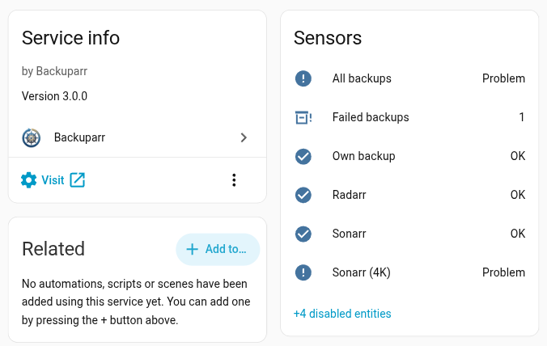
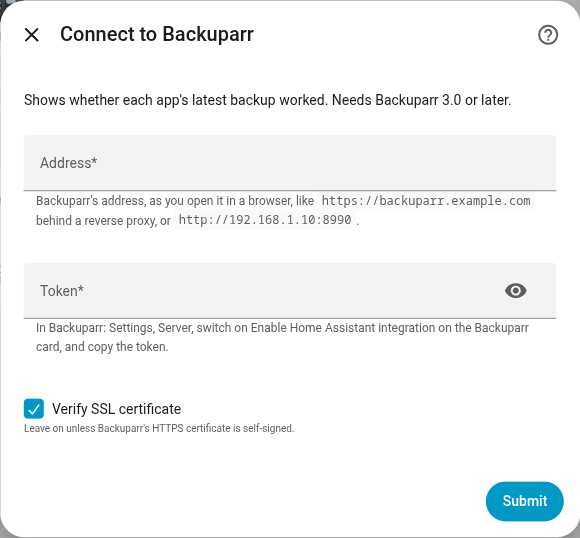
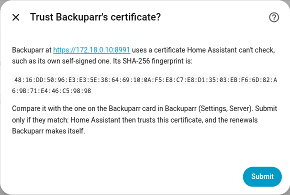

# Backuparr for Home Assistant

See in Home Assistant whether your [Backuparr](https://github.com/rsaturns/backuparr)
backups worked, and use it in dashboards and automations.



<!-- ha-marketplace:exclude-start -->
## Install

[](https://my.home-assistant.io/redirect/hacs_repository/?owner=rsaturns&repository=ha-backuparr&category=integration)

Select the badge to open this repository in Home Assistant's **Marketplace**
(2026.11 and later) or in HACS, then select **Install** (**Download** in HACS).

To add it by hand instead:

1. In Home Assistant, go to **Settings** > **Marketplace**.
2. In the upper-right corner, select **Add from link**.
3. Under **GitHub link**, enter `https://github.com/rsaturns/ha-backuparr` and
   select **Add**.
4. Select **Backuparr** in the list, then select **Install**.

See [Custom repositories](https://www.home-assistant.io/integrations/marketplace/#custom-repositories)
in Home Assistant's docs.

On Home Assistant 2026.10, in HACS: select the three dots menu >
**Custom repositories**, enter `https://github.com/rsaturns/ha-backuparr`,
pick **Integration** as the type, and select **Add**.
<!-- ha-marketplace:exclude-end -->

## Requirements

- Backuparr 3.0 or later.
- Home Assistant 2026.10 or later.

## Set up

1. In Backuparr, open **Settings** > **Server**, switch on **Enable Home
   Assistant integration** on the Backuparr card, and copy the token.
2. In Home Assistant, go to **Settings** > **Devices & services** > **Add
   integration** and pick **Backuparr**.
3. Enter Backuparr's address, like `https://192.168.1.10:8991`, and the token.
4. Home Assistant can't check Backuparr's own self-signed certificate, so it
   shows its fingerprint. Compare it with the one on the Backuparr card
   (**Settings** > **Server**) and select **Submit** if they match.





Home Assistant then trusts that certificate, and the renewals Backuparr makes
itself, and checks it before every request. Behind a reverse proxy with a
certificate from a real authority, there's nothing to compare.

Leave **Verify SSL certificate** on. Turning it off accepts any certificate,
so anyone between Home Assistant and Backuparr could read the token.
Plain `http://` works too, but sends the token readable.

## Entities

One **Backuparr** device, with:

| Entity | What it shows |
| --- | --- |
| **All backups** | Problem when any app's latest backup failed. Attributes: total, succeeded, failed, running. |
| One per app, like **Radarr** | Problem when that app's latest backup failed. Unknown before its first backup. Attributes: last run, last success, error. |
| **Own backup** | The same for Backuparr's own backup, while it's on. |
| **Failed backups** | How many apps' latest backups failed. |
| **Last backup**, one per app | When its latest successful backup finished. Off by default. |

Apps you add or remove in Backuparr are added or removed here. Home Assistant
checks every 5 minutes.

## Example: a notification

```yaml
triggers:
  - trigger: state
    entity_id: binary_sensor.backuparr_all_backups
    to: "on"
actions:
  - action: notify.notify
    data:
      message: >
        {{ states('sensor.backuparr_failed_backups') }} backups failed.
        Check Backuparr's Overview.
```

## If something's wrong

- **Backuparr didn't accept the token:** you made a new token, or switched the
  integration off and on. Home Assistant asks for the new one under
  **Settings** > **Devices & services**.
- **Couldn't reach Backuparr:** the entities show as unavailable until
  Backuparr answers again.
- **Backuparr's certificate changed:** after setting Backuparr up again
  without its own backup, or changing its certificate. **Settings** >
  **Repairs** shows the new fingerprint to compare and trust; until then,
  the token isn't sent.
- **Change Backuparr's address:** the **Reconfigure** option on the integration.
- **Diagnostics** leave out Backuparr's address and token.

The token only reads backup status. It can't change settings, run a backup or
restore, or read app credentials.

## License

[AGPL-3.0](LICENSE), like Backuparr.
